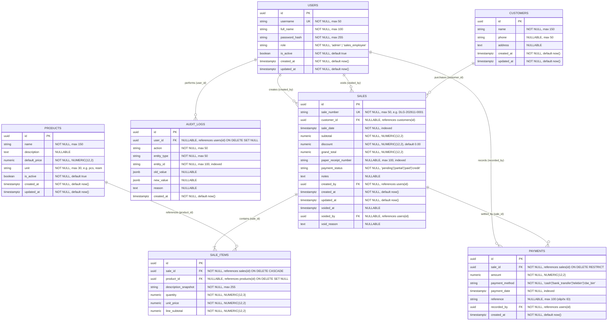

# Delgone Digital Sales Ledger — Database Design & Schema Specification

**Document Version:** 1.0.0  
**Target RDBMS:** PostgreSQL 16+  
**ORM:** SQLAlchemy 2.0 (Declarative Mapping)  
**Migration Engine:** Alembic  

---

## 1. Entity-Relationship (ER) Diagram

---

## 2. Table Specifications & Column Details

### 2.1 Table: `users`
Stores employee and administrative credentials and access roles.

| Column | Data Type | Constraints | Description |
| :--- | :--- | :--- | :--- |
| `id` | `UUID` | `PRIMARY KEY`, default `uuid_generate_v4()` | Unique system user ID |
| `username` | `VARCHAR(50)` | `NOT NULL, UNIQUE, INDEX` | Unique login username (e.g. `abebe_k`) |
| `full_name` | `VARCHAR(100)` | `NOT NULL` | Employee full legal name |
| `password_hash` | `VARCHAR(255)` | `NOT NULL` | Argon2id or Bcrypt salted hash |
| `role` | `VARCHAR(20)` | `NOT NULL, DEFAULT 'sales_employee'` | `admin` or `sales_employee` |
| `is_active` | `BOOLEAN` | `NOT NULL, DEFAULT TRUE` | Active employment status flag |
| `created_at` | `TIMESTAMPTZ` | `NOT NULL, DEFAULT NOW()` | Record creation timestamp |
| `updated_at` | `TIMESTAMPTZ` | `NOT NULL, DEFAULT NOW()` | Record last modification timestamp |

### 2.2 Table: `customers`
Stores client details for business-to-business (B2B) and recurring retail purchasers.

| Column | Data Type | Constraints | Description |
| :--- | :--- | :--- | :--- |
| `id` | `UUID` | `PRIMARY KEY`, default `uuid_generate_v4()` | Unique customer ID |
| `name` | `VARCHAR(150)` | `NOT NULL, INDEX` | Customer or company name |
| `phone` | `VARCHAR(50)` | `NULLABLE, INDEX` | Primary phone contact |
| `address` | `TEXT` | `NULLABLE` | Physical shop or delivery address |
| `created_at` | `TIMESTAMPTZ` | `NOT NULL, DEFAULT NOW()` | Customer registration timestamp |
| `updated_at` | `TIMESTAMPTZ` | `NOT NULL, DEFAULT NOW()` | Last profile update timestamp |

*Note: Walk-in customers do not require a row in `customers`. The `sales.customer_id` column is nullable to represent casual walk-in purchases.*

### 2.3 Table: `products`
The standard catalog for printing supplies, inks, papers, and equipment.

| Column | Data Type | Constraints | Description |
| :--- | :--- | :--- | :--- |
| `id` | `UUID` | `PRIMARY KEY`, default `uuid_generate_v4()` | Product ID |
| `name` | `VARCHAR(150)` | `NOT NULL, INDEX` | Item name (e.g., A4 Paper 80gsm, Toner Cartridge 85A) |
| `description` | `TEXT` | `NULLABLE` | Specifications, brand, or packing details |
| `default_price`| `NUMERIC(12, 2)`| `NOT NULL, CHECK (default_price >= 0)` | Base unit price in Ethiopian Birr (ETB) |
| `unit` | `VARCHAR(30)` | `NOT NULL, DEFAULT 'pcs'` | Standard unit of measure (pcs, ream, box, roll) |
| `is_active` | `BOOLEAN` | `NOT NULL, DEFAULT TRUE` | True if available for counter selection |
| `created_at` | `TIMESTAMPTZ` | `NOT NULL, DEFAULT NOW()` | Catalog creation timestamp |
| `updated_at` | `TIMESTAMPTZ` | `NOT NULL, DEFAULT NOW()` | Catalog update timestamp |

### 2.4 Table: `sales`
The central ledger transaction table recording all finalized sales.

| Column | Data Type | Constraints | Description |
| :--- | :--- | :--- | :--- |
| `id` | `UUID` | `PRIMARY KEY`, default `uuid_generate_v4()` | Sale transaction UUID |
| `sale_number` | `VARCHAR(50)` | `NOT NULL, UNIQUE, INDEX` | Sequential sale number (e.g. `DLG-202611-0001`) |
| `customer_id` | `UUID` | `NULLABLE, FK -> customers(id) ON DELETE SET NULL, INDEX` | Customer reference (null for walk-ins) |
| `sale_date` | `TIMESTAMPTZ` | `NOT NULL, INDEX` | Official date & time of sale |
| `subtotal` | `NUMERIC(12, 2)`| `NOT NULL, CHECK (subtotal >= 0)` | Sum of line subtotals |
| `discount` | `NUMERIC(12, 2)`| `NOT NULL, DEFAULT 0.00, CHECK (discount >= 0)` | Overall discount applied (in ETB) |
| `grand_total` | `NUMERIC(12, 2)`| `NOT NULL, CHECK (grand_total >= 0)` | Net payable amount (subtotal - discount) |
| `paper_receipt_number` | `VARCHAR(100)` | `NULLABLE, INDEX` | Handwritten receipt / manual invoice reference |
| `payment_status` | `VARCHAR(20)` | `NOT NULL, DEFAULT 'pending'` | `pending`, `partial`, `paid`, `credit` |
| `notes` | `TEXT` | `NULLABLE` | Counter remarks or delivery instructions |
| `created_by` | `UUID` | `NOT NULL, FK -> users(id) ON DELETE RESTRICT, INDEX` | User ID of employee recording the sale |
| `created_at` | `TIMESTAMPTZ` | `NOT NULL, DEFAULT NOW()` | Creation timestamp |
| `updated_at` | `TIMESTAMPTZ` | `NOT NULL, DEFAULT NOW()` | Last update timestamp |
| `voided_at` | `TIMESTAMPTZ` | `NULLABLE` | Timestamp if transaction was voided |
| `voided_by` | `UUID` | `NULLABLE, FK -> users(id) ON DELETE SET NULL` | Manager/User who approved the void |
| `void_reason` | `TEXT` | `NULLABLE` | Mandatory justification for voiding |

### 2.5 Table: `sale_items`
Individual line items belonging to a sale transaction.

| Column | Data Type | Constraints | Description |
| :--- | :--- | :--- | :--- |
| `id` | `UUID` | `PRIMARY KEY`, default `uuid_generate_v4()` | Unique line item ID |
| `sale_id` | `UUID` | `NOT NULL, FK -> sales(id) ON DELETE CASCADE, INDEX` | Parent sale record |
| `product_id` | `UUID` | `NULLABLE, FK -> products(id) ON DELETE SET NULL, INDEX` | Catalog product (null for manual entry) |
| `description_snapshot` | `VARCHAR(255)` | `NOT NULL` | Description frozen at the time of sale |
| `quantity` | `NUMERIC(12, 3)`| `NOT NULL, CHECK (quantity > 0)` | Quantity sold (supports decimals for rolls/meters) |
| `unit_price` | `NUMERIC(12, 2)`| `NOT NULL, CHECK (unit_price >= 0)` | Price per unit frozen at the time of sale |
| `line_subtotal`| `NUMERIC(12, 2)`| `NOT NULL, CHECK (line_subtotal >= 0)` | Calculated as quantity * unit_price |

### 2.6 Table: `payments`
Individual payment transactions settling all or part of a sale.

| Column | Data Type | Constraints | Description |
| :--- | :--- | :--- | :--- |
| `id` | `UUID` | `PRIMARY KEY`, default `uuid_generate_v4()` | Payment record ID |
| `sale_id` | `UUID` | `NOT NULL, FK -> sales(id) ON DELETE RESTRICT, INDEX` | Associated sale record |
| `amount` | `NUMERIC(12, 2)`| `NOT NULL, CHECK (amount > 0)` | Payment amount received in ETB |
| `payment_method` | `VARCHAR(30)` | `NOT NULL` | `cash`, `bank_transfer`, `telebirr`, `cbe_birr` |
| `payment_date`| `TIMESTAMPTZ` | `NOT NULL, INDEX` | Date payment received |
| `reference` | `VARCHAR(100)` | `NULLABLE, INDEX` | Bank transaction ID, deposit slip #, or voucher |
| `recorded_by` | `UUID` | `NOT NULL, FK -> users(id) ON DELETE RESTRICT, INDEX` | Employee receiving and logging funds |
| `created_at` | `TIMESTAMPTZ` | `NOT NULL, DEFAULT NOW()` | System entry timestamp |

### 2.7 Table: `audit_logs`
Immutable system audit trail tracking critical state mutations.

| Column | Data Type | Constraints | Description |
| :--- | :--- | :--- | :--- |
| `id` | `UUID` | `PRIMARY KEY`, default `uuid_generate_v4()` | Audit event ID |
| `user_id` | `UUID` | `NULLABLE, FK -> users(id) ON DELETE SET NULL, INDEX` | Actor who executed the action |
| `action` | `VARCHAR(50)` | `NOT NULL` | Action code (e.g. `CREATE`, `UPDATE`, `VOID`) |
| `entity_type` | `VARCHAR(50)` | `NOT NULL` | Target table (e.g. `Sale`, `Payment`, `Product`) |
| `entity_id` | `VARCHAR(100)` | `NOT NULL, INDEX` | Identifier of the affected record |
| `old_value` | `JSONB` | `NULLABLE` | JSON snapshot before modification |
| `new_value` | `JSONB` | `NULLABLE` | JSON snapshot after modification |
| `reason` | `TEXT` | `NULLABLE` | Explanation (mandatory for VOID operations) |
| `created_at` | `TIMESTAMPTZ` | `NOT NULL, DEFAULT NOW()` | Event log timestamp |

---

## 3. Foreign Key Deletion and Update Policies

1. **`users` -> `sales.created_by` / `payments.recorded_by` (`ON DELETE RESTRICT`):** An employee record cannot be hard-deleted if they have authored any sales or logged any payments. Inactive employees must have `is_active = FALSE`.
2. **`sales` -> `sale_items` (`ON DELETE CASCADE`):** If a draft sale is purged, its constituent lines are deleted. However, finalized sales are never deleted; they are marked void with `voided_at`.
3. **`sales` -> `payments` (`ON DELETE RESTRICT`):** A sale with recorded payments cannot be removed from the database, safeguarding financial audit trails.
4. **`products` -> `sale_items.product_id` (`ON DELETE SET NULL`):** If a product is archived or removed from the catalog, historical sale items remain intact with their frozen `description_snapshot` and prices.

---

## 4. Indexing & Optimization Strategy

1. **Unique Indexes:**
   - `users(username)`: Instant lookup during authentication.
   - `sales(sale_number)`: O(1) retrieval for sale slips.
2. **B-Tree Indexes for Range Queries & Reconciliation:**
   - `sales(sale_date)`: Accelerates daily, weekly, and monthly reporting.
   - `sales(paper_receipt_number)`: Accelerates cross-referencing physical paper books.
   - `sales(payment_status)`: Filters pending and credit transactions.
   - `payments(payment_date)`: Daily cash and bank reconciliation summaries.
   - `payments(reference)`: Duplicate payment submission prevention.
3. **Foreign Key Indexes:**
   - `sales(customer_id)`, `sales(created_by)`
   - `sale_items(sale_id)`, `sale_items(product_id)`
   - `payments(sale_id)`, `payments(recorded_by)`
   - `audit_logs(entity_id)`, `audit_logs(user_id)`
