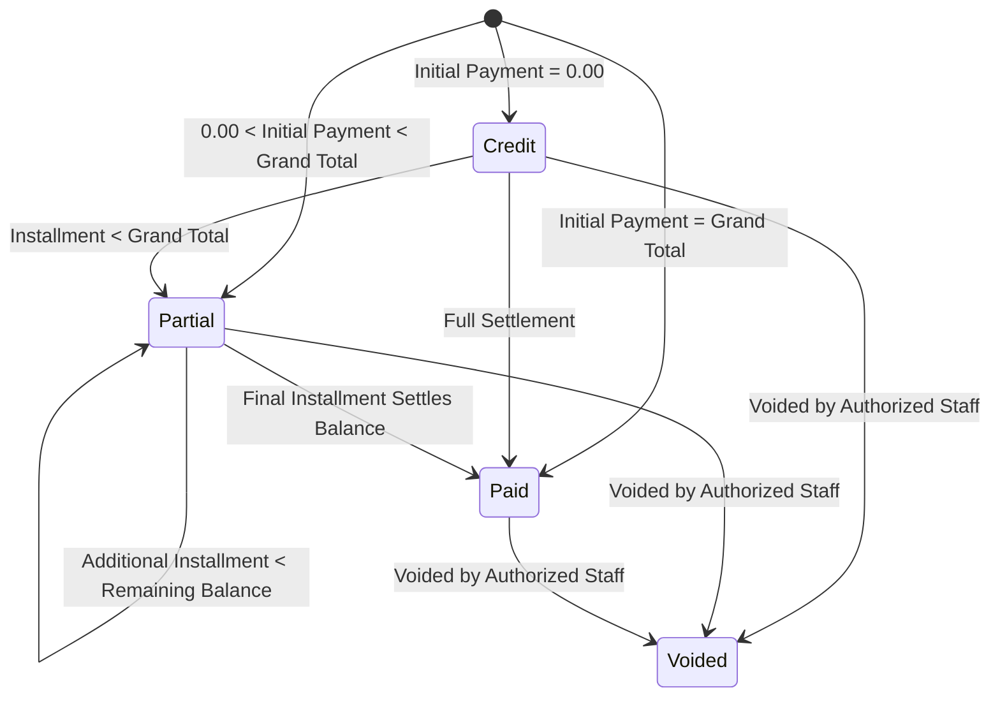

# Payment Logic & Financial Precision Documentation

## 1. Monetary Precision & Rounding Rules

All financial calculations in the **Delgone Digital Sales Ledger** strictly utilize exact `Decimal` arithmetic (`Numeric(12, 2)` in PostgreSQL / SQLite). Floating-point arithmetic (`float`) is strictly prohibited throughout the backend to prevent IEEE 754 precision drift.

### Currency Specifications
- **Currency**: Ethiopian Birr (`ETB`).
- **Monetary Unit Decimal Places**: 2 decimal places (`0.01 ETB`).
- **Rounding Mode**: `ROUND_HALF_UP` (`Decimal.quantize(Decimal("0.01"), rounding=ROUND_HALF_UP)`).
- **Quantity Precision**: 3 decimal places (`Numeric(10, 3)`), supporting fractional purchases (e.g., `2.500` meters or rolls).

---

## 2. Calculation Equations

$$\text{Line Subtotal} = \text{round}_{2}(\text{Quantity} \times \text{Unit Price})$$

$$\text{Sale Subtotal} = \sum_{i=1}^{n} \text{Line Subtotal}_{i}$$

$$\text{Grand Total} = \max(0.00, \text{Sale Subtotal} - \text{Discount})$$

$$\text{Total Paid} = \sum_{j=1}^{m} \text{Payment Amount}_{j}$$

$$\text{Outstanding Balance} = \max(0.00, \text{Grand Total} - \text{Total Paid})$$

### Business Validation Rules
1. **Discount Cap**: $\text{Discount} \le \text{Sale Subtotal}$. A discount cannot exceed the transaction subtotal.
2. **Initial Payment Cap**: $\text{Initial Payment} \le \text{Grand Total}$. Down payments cannot exceed the grand total.
3. **Subsequent Payment Cap**: $\text{Payment Amount} \le \text{Outstanding Balance}$. Overpayments are rejected with HTTP 400.
4. **Voided Sales**: Cannot receive payments. Any attempt to post payments against a voided sale is rejected with HTTP 400.

---

## 3. Transaction Payment States



### State Definitions
- `paid`: $\text{Total Paid} = \text{Grand Total}$ and $\text{Outstanding Balance} = 0.00$. Transaction is completely settled.
- `partial`: $0.00 < \text{Total Paid} < \text{Grand Total}$ and $\text{Outstanding Balance} > 0.00$. Customer made a down payment or installment.
- `credit`: $\text{Total Paid} = 0.00$ and $\text{Outstanding Balance} = \text{Grand Total}$. Pure credit transaction.
- `voided`: Transaction cancelled. Excluded from active revenue, dashboard metrics, and customer credit totals.

---

## 4. Supported Payment Methods

| Method Code | Display Label | Description & Validation |
|---|---|---|
| `cash` | Cash | Physical currency received at the counter drawer. |
| `bank_transfer` | Bank Transfer | Direct bank transfer (Commercial Bank of Ethiopia - CBE, Awash Bank, Dashen Bank, etc.). Requires or accepts bank transaction slip reference. |
| `telebirr` | Telebirr | Ethio Telecom mobile wallet payment. Records transaction code. |
| `cbe_birr` | CBE Birr | Commercial Bank of Ethiopia mobile wallet payment. |
| `credit` | Credit Sale | No initial funds received; full balance remains outstanding under customer account. |

---

## 5. Idempotency & Concurrency Protection

1. **Row-Level Locking**:
   When processing payments or voiding transactions, SQLAlchemy applies `with_for_update()` to lock the `Sale` row:
   ```python
   sale = db.scalar(
       select(Sale).where(Sale.id == sale_id).with_for_update()
   )
   ```
   This prevents concurrent requests from double-crediting payments or causing race conditions.
2. **Idempotency Keys**:
   Both `Sale` and `Payment` models include unique, indexed `idempotency_key` columns (`String(100)`). If network retries resubmit identical keys, the existing record is safely returned without duplicate charges.
