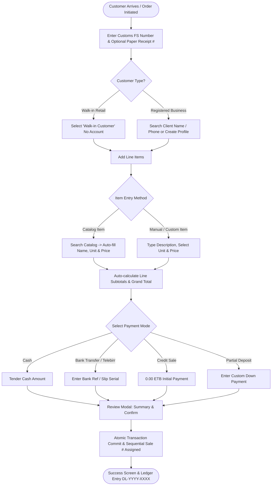

# Sales Workflow Documentation — Delgone Digital Sales Ledger

## 1. Overview

The **Sales Management and Payment Recording Engine** provides Delgone Trading PLC with a reliable point-of-sale and sales ledger platform to replace handwritten counter receipt books with a centralized digital ledger.

The workflow is tailored for high-volume sales counter operations in Addis Ababa, balancing rapid transaction entry with rigorous regulatory compliance and audit trails.

---

## 2. Counter Sales Workflow

---

## 3. Key Components & Business Rules

### 3.1 Customs FS Number (Fiscal Reference)
- **Mandatory**: Under Ethiopian Ministry of Revenues and Customs regulations, sales receipts generated by cash register machines have an official FS number (Fiscal Serial).
- **Format**: Preserves all characters, letters, hyphens, and leading zeros (e.g., `FS-2026-00451`).
- **Auditability**: The FS number cannot be arbitrarily rewritten; changes require a logged transaction correction with a mandatory justification reason.

### 3.2 Sequential Sale Numbering (`DL-YYYY-XXXX`)
- Format: `DL-YYYY-XXXX` (e.g., `DL-2026-0001`).
- **Addis Ababa Timezone**: Generated based on `Africa/Addis_Ababa` local business year.
- **Concurrency Safe**: Uses explicit row-level locking (`with_for_update()`) on dedicated sequence tables (`sale_sequences`) to eliminate race conditions under concurrent counter checkouts.
- **Permanent**: Numbers are never re-used, even if a transaction is subsequently voided.

### 3.3 Product Entry: Catalog vs. Manual Line Items
Delgone Trading PLC sells both standard cataloged items (paper reams, photo paper, printer ink) and customized supplies (cut vinyl rolls, custom laminate, specialized printing orders).
1. **Catalog Method**:
   - Live typeahead product lookup (`/api/products/search`).
   - Automatically populates item description, default unit price in ETB, and standard unit of measurement.
   - Price can be authorized and adjusted per line item.
2. **Manual Method**:
   - Counter staff can freely enter descriptions for non-catalog items.
   - Does not require creating a permanent inventory catalog entry.
   - Freezes immutable price snapshots in `sale_items.description_snapshot`, `unit`, `quantity`, `unit_price`, and `line_subtotal`.

### 3.4 Customer Handling
- **Walk-in Customers**: Set `customer_id = None`. Allows rapid counter sales without forcing customer registration.
- **Registered Customers**: Searchable by business name, contact person, or phone number.
- **Instant Profile Creation**: Staff can create a new customer record directly inside the New Sale modal without leaving the sales screen.
